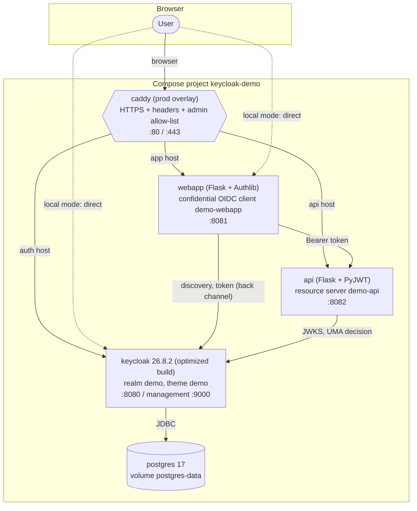
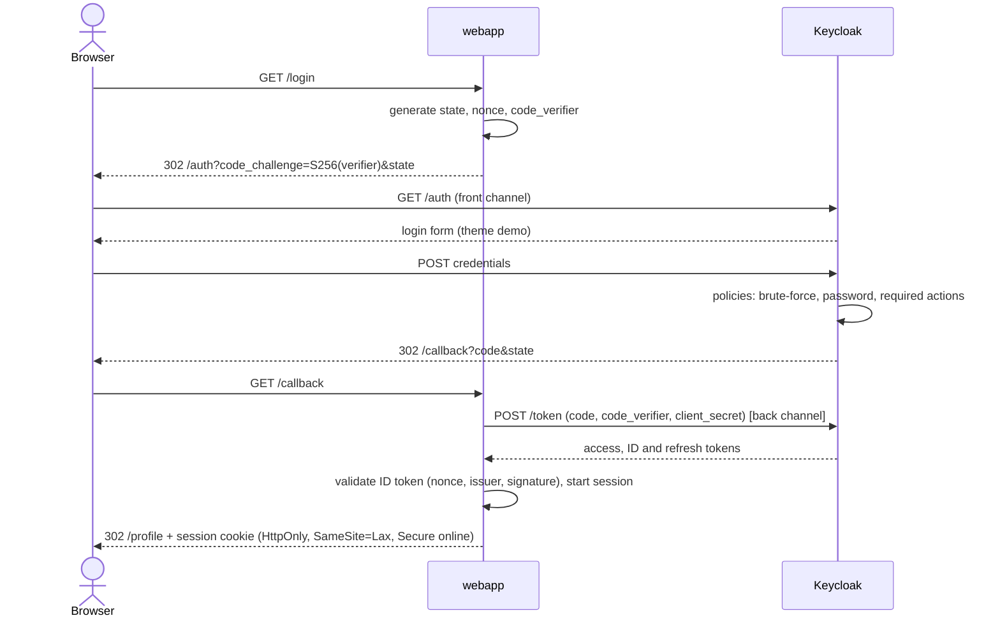
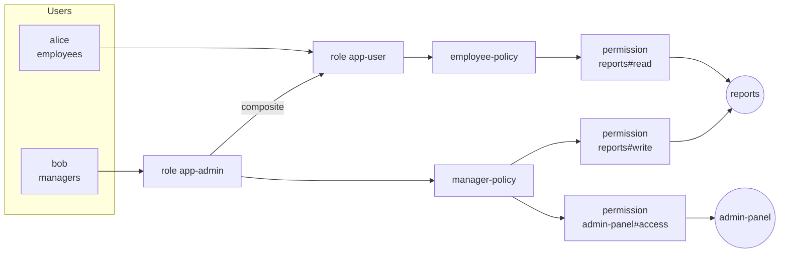
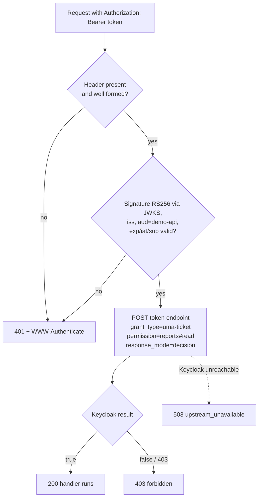
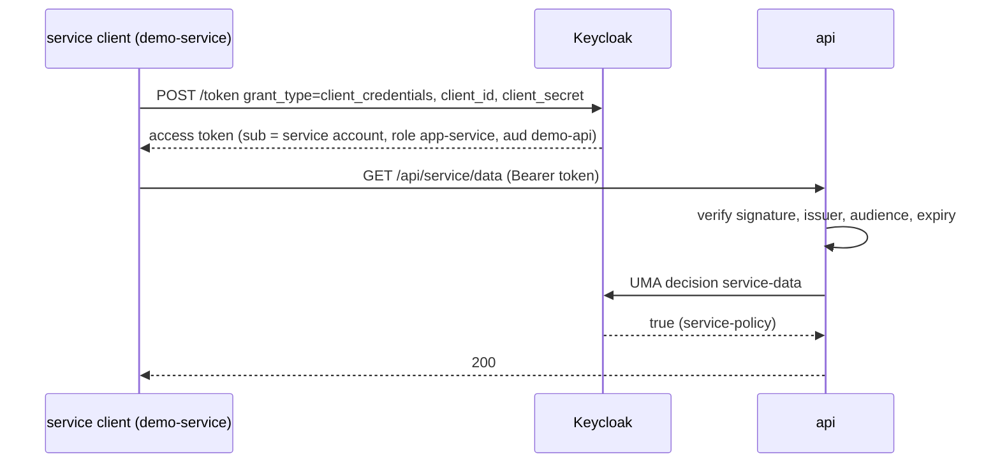

# Architecture

## Components

| Component | Technology | Responsibility | State |
|---|---|---|---|
| `keycloak` | Official image, built with `kc.sh build` (`KC_DB=postgres`, health and metrics on) | Authentication, SSO sessions, token issuing, authorization policies, admin console, events | PostgreSQL |
| `postgres` | PostgreSQL 17 | Persists realms, users, sessions, events | Named volume |
| `webapp` | Flask 3, Authlib, gunicorn | Browser-facing OIDC client; logs users in, shows claims, calls the API with the user's token | Stateless (signed cookie) |
| `api` | Flask 3, PyJWT, gunicorn | OAuth 2.0 resource server; validates tokens locally and asks Keycloak for permission decisions | Stateless |
| `caddy` (online only) | Caddy 2 | TLS termination with automatic certificates, security headers, admin allow-list | Volumes `caddy-data`, `caddy-config` |

## Authentication flow (OIDC authorization code + PKCE)

Logout is RP-initiated: `/logout` clears the local session and redirects to Keycloak's `end_session_endpoint`
with `id_token_hint`, ending the SSO session; Keycloak returns to `WEBAPP_PUBLIC_URL/`.

## Authorization model

Two layers cooperate:

1. **Identity roles and groups** - `employees` grants realm role `app-user`; `managers` grants `app-admin`
   (composite, includes `app-user`). They appear in the token as `realm_access.roles` and `groups`.
2. **Keycloak Authorization Services** on client `demo-api` - the API never hard-codes who may do what.
   It asks Keycloak for a decision on `resource#scope`; Keycloak evaluates the policies in the realm.

Request path for `GET /api/reports`:

## Service-to-service flow (client credentials)

No user and no browser are involved; the same API code path and the same policy engine decide, which is why the
service account gets 403 on `/api/reports` and `/api/admin`.

## Network and URL design

Browsers and containers reach Keycloak by different names, which is the classic Keycloak container pitfall:

| Actor | Address used | Why |
|---|---|---|
| Browser | `KC_HOSTNAME` (`http://localhost:8080` or `https://auth.example.com`) | Public front channel; defines the token issuer |
| webapp, api (back channel) | `http://keycloak:8080` | Container-to-container, no TLS round trip through the proxy |
| Token validation in the API | `OIDC_ISSUER` = `KC_HOSTNAME/realms/<realm>` | The issuer is the public one, even though keys are fetched internally |

`KC_HOSTNAME_BACKCHANNEL_DYNAMIC=true` lets Keycloak answer internal requests with endpoints derived from the
request host, while front-channel URLs and the `iss` claim stay on `KC_HOSTNAME`.

## Configuration as code

* `keycloak/realm/demo-realm.json` is baked into the image (`/opt/keycloak/data/import`) and imported with
  `--import-realm` on first start. `${PLACEHOLDER}` values are resolved from the container environment, so the
  repository contains no secrets.
* The build stage of `keycloak/Dockerfile` runs `kc.sh build` once, so the runtime starts with `--optimized`
  (faster start, fixed DB vendor, health and metrics enabled).
* The theme `keycloak/themes/demo` extends the built-in `keycloak.v2` login theme with one stylesheet.

## Security decisions

| Topic | Decision |
|---|---|
| Browser client | Confidential client, code flow + PKCE S256, exact redirect URI, implicit and password grants off |
| Service client | Client credentials only, least-privilege role `app-service`, secret from `.env`, token cached in memory |
| Tokens | Access token 5 min; tokens stay server-side in a signed HttpOnly cookie session, never in browser storage |
| CSRF | State/nonce on login; per-session CSRF token on every POST to the API proxy route; SameSite=Lax cookies |
| API | Signature + issuer + audience + required claims; algorithm allow-list rejects `none`; authorization delegated to Keycloak policies; fail closed (deny on error) |
| Audience | Audience mapper adds `demo-api` so a token minted for another API is not accepted |
| Credentials | Brute-force detection, password policy, passwords and secrets only via `.env` (random, mode 600, git-ignored) |
| Containers | Non-root users, multi-stage builds, pinned tags, ports bound to `127.0.0.1`, management port 9000 not published |
| Transport | Online: Caddy terminates TLS, HSTS, `nosniff`, referrer policy, optional admin allow-list |
| Known demo trade-offs | Self-registration, `demo-cli` password grant and fixed demo users exist for convenience; each can be switched off (see [Deployment hardening](Deployment.md#hardening-checklist)) |

## Testing strategy

| Level | Tooling | Scope |
|---|---|---|
| Unit | pytest (78 tests) | Token validation (expiry, issuer, audience, forged and `alg=none` tokens), policy client, API endpoints with a fake policy point, web app flows with a stubbed Authlib client, service client token caching, helpers |
| Configuration | pytest | Realm file consistency (policy/resource/scope references), no clear-text secrets, every compose variable documented, every realm placeholder passed to Keycloak, Dockerfile policy |
| End to end | `scripts/verify.sh` | Runs against the live stack, local or online: discovery, JWKS, PKCE, 401/403/200/201 matrix with real user and service tokens |
