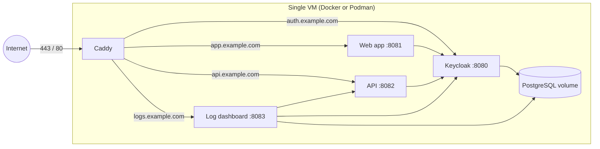

# Online deployment

The same containers run online. The overlay `docker-compose.prod.yml` adds **Caddy**, which obtains and renews
Let's Encrypt certificates automatically and forwards traffic to Keycloak, the web app, the API and the log dashboard.



Only ports 80 and 443 are published to the internet. The service ports stay bound to `127.0.0.1` (`BIND_ADDRESS`).

> Status: the production overlay was exercised end to end on a developer machine by simulating the online setup with
> `https://auth.localhost`, `app.localhost` and `api.localhost` (done before the log dashboard and its `logs.localhost` host were added; repeat it with four names before relying on the dashboard online) (Caddy issues certificates from its internal CA for
> `.localhost` names). Verified: HTTPS everywhere, HTTP to HTTPS redirect, HSTS header, token issuer
> `https://auth.localhost/realms/demo`, `VERIFY_CURL_OPTS=-k scripts/verify.sh` = `VERIFY OK`, and `/admin` plus the
> master realm answering 403 outside `ADMIN_ALLOWED_CIDR`. Not testable without a public server: the Let's Encrypt
> (ACME) issuance itself. It needs DNS pointing at the server and ports 80/443 reachable; step 7 shows how to confirm it.
> You can repeat the simulation: set the `*_PUBLIC_*`/`*_HOSTNAME` values to the `.localhost` names, run
> `scripts/start.sh --prod`, then `VERIFY_CURL_OPTS=-k scripts/verify.sh`.

## Option A - any Linux VM (recommended path)

Works on any provider that gives you a VM with a public IP (IBM Cloud VSI, AWS EC2, Azure VM, GCP Compute Engine,
Hetzner, DigitalOcean, ...). Sizing: 2 vCPU and 4 GB RAM minimum for this demo (Keycloak needs about 1 GB heap headroom).

### 1. Provision the server

* Ubuntu 24.04 LTS (or similar), public IPv4, inbound firewall rules: **22** (restrict to your IP), **80**, **443**.
* Do **not** open 8080, 8081, 8082 or 8083.

### 2. Install a container engine

```bash
# Docker (Ubuntu)
curl -fsSL https://get.docker.com | sudo sh && sudo usermod -aG docker $USER && newgrp docker
docker compose version
```

(Podman works too: `sudo apt install podman docker-compose`; set `COMPOSE_CMD="podman compose"`.
Rootless Podman cannot bind ports 80/443 without `sysctl net.ipv4.ip_unprivileged_port_start=80`.)

### 3. DNS names

Create four `A` records pointing at the server IP (or one wildcard):

```
auth.example.com   A  <server-ip>
app.example.com    A  <server-ip>
api.example.com    A  <server-ip>
logs.example.com   A  <server-ip>
```

No domain? Use [sslip.io](https://sslip.io): for IP `203.0.113.10` the names `auth.203-0-113-10.sslip.io`,
`app.203-0-113-10.sslip.io`, `api.203-0-113-10.sslip.io` and `logs.203-0-113-10.sslip.io` resolve automatically.

### 4. Get the code and configure

```bash
git clone <this repository> keycloak-implementation && cd keycloak-implementation
scripts/init-env.sh        # random secrets
nano .env                  # edit the values below
```

Set in `.env` (replace `example.com` by your domain):

```dotenv
KC_PUBLIC_HOST=auth.example.com
APP_PUBLIC_HOST=app.example.com
API_PUBLIC_HOST=api.example.com
LOGAPP_PUBLIC_HOST=logs.example.com
ACME_EMAIL=you@yourdomain.tld

KC_HOSTNAME=https://auth.example.com
WEBAPP_PUBLIC_URL=https://app.example.com
API_PUBLIC_URL=https://api.example.com
LOGAPP_PUBLIC_URL=https://logs.example.com
BIND_ADDRESS=127.0.0.1

# demo hardening - see the checklist below
DEMO_REGISTRATION_ALLOWED=false
DEMO_CLI_ENABLED=true         # keep true only until step 7 is done, then set false and re-import (see checklist)
ADMIN_ALLOWED_CIDR="203.0.113.0/24"   # your office/VPN range; keep "0.0.0.0/0 ::/0" only while testing
```

### 5. Start

```bash
scripts/start.sh --prod
```

This builds the images and starts PostgreSQL, Keycloak, the API, the web app, the log dashboard and Caddy. The readiness loop in
`start.sh` checks `127.0.0.1`, so it works behind the proxy. Caddy requests the certificates on first contact
(allow a minute; watch `docker compose -f docker-compose.yml -f docker-compose.prod.yml logs -f caddy`).

### 6. First login to the admin console

`https://auth.example.com/admin` with `KC_BOOTSTRAP_ADMIN_USERNAME` and the password from `.env`.
Create a permanent admin user with a strong password and MFA, then delete the bootstrap admin
(Keycloak shows a banner reminding you).

### 7. Verify the deployment

From your laptop (any machine with `curl` and the `.env` values; copy only the variables needed):

```bash
# a) certificates and discovery
curl -sI https://auth.example.com/realms/demo/.well-known/openid-configuration | head -1     # HTTP/2 200
curl -s  https://auth.example.com/realms/demo/.well-known/openid-configuration | python3 -m json.tool | grep '"issuer"'
#    -> "issuer": "https://auth.example.com/realms/demo"     (must be https and your public host)

# b) full end-to-end check (uses the public URLs from .env)
scripts/verify.sh                                           # expected: VERIFY OK (add VERIFY_CURL_OPTS=-k only for self-signed tests)

# c) browser test
#    open https://app.example.com -> Sign in -> alice or bob -> try the four API buttons
#    alice: reports 200, write/admin 403.  bob: all allowed.

#    open https://logs.example.com -> sign in as bob -> events, filters, Admin page statistics

# d) negative checks
curl -s -o /dev/null -w '%{http_code}\n' https://api.example.com/api/reports                  # 401
curl -s -o /dev/null -w '%{http_code}\n' https://logs.example.com/dashboard                      # 302 (anonymous users are sent to /login)
curl -s -o /dev/null -w '%{http_code}\n' http://app.example.com                               # 308 redirect to https
# from an address outside ADMIN_ALLOWED_CIDR:
curl -s -o /dev/null -w '%{http_code}\n' https://auth.example.com/admin/                      # 403
```

Run `scripts/verify.sh` on the server itself too: it reads the same `.env`, so it tests the public HTTPS URLs.

### 8. Operate

| Task | Command (append `-f docker-compose.yml -f docker-compose.prod.yml` or export `MODE=prod` for scripts) |
|---|---|
| Logs | `docker compose -f docker-compose.yml -f docker-compose.prod.yml logs -f` |
| Update the stack | `git pull && scripts/start.sh --prod` |
| Upgrade Keycloak | change `KEYCLOAK_VERSION`, `scripts/start.sh --prod` (back up first) |
| Stop | `scripts/stop.sh --prod` |
| Database backup (includes the `logapp` schema) | `docker compose exec postgres pg_dump -U $POSTGRES_USER $POSTGRES_DB > backup-$(date +%F).sql` |
| Restore | `docker compose exec -T postgres psql -U $POSTGRES_USER $POSTGRES_DB < backup.sql` |
| Destroy everything | `scripts/stop.sh --prod --volumes` (**deletes the database**) |

## Option B - other platforms

The four application images are standard OCI images, so any container service can run them. What each platform
must provide is the same:

| Requirement | Detail |
|---|---|
| Keycloak container | Build `keycloak/Dockerfile`; start command `start --optimized --import-realm` (already the image default). Needs `KC_DB_URL`, `KC_DB_USERNAME`, `KC_DB_PASSWORD`, `KC_HOSTNAME` (public https URL), `KC_HTTP_ENABLED=true`, `KC_PROXY_HEADERS=xforwarded` (or `forwarded`) when TLS is terminated by the platform, the bootstrap admin variables and the realm placeholder variables |
| Database | Managed PostgreSQL 15+ (the image is built with `KC_DB=postgres`) |
| TLS | Terminated by the platform load balancer; Keycloak must see `X-Forwarded-Proto/Host` |
| Health probe | `GET :9000/health/ready` (management port; do not expose it publicly) |
| Back channel | The API and web app need to reach Keycloak. Point `OIDC_DISCOVERY_URL` to the **internal** address when available, otherwise to `KC_HOSTNAME`; `OIDC_ISSUER` must always equal the public issuer. `KC_HOSTNAME_BACKCHANNEL_DYNAMIC=true` is only needed when the internal address differs from `KC_HOSTNAME` |
| Web app and API | One instance each, env vars as in `docker-compose.yml`; `WEBAPP_PUBLIC_URL` must be the public https URL |
| Log dashboard | **Exactly one always-on instance** (tokens live in its memory, the event sync is a background thread; scale-to-zero stops the sync and signs users out). Needs `LOGAPP_DATABASE_URL`, `LOGAPP_PUBLIC_URL`, `LOGAPP_SESSION_SECRET`, `OIDC_*`, `API_BASE_URL`, `SERVICE_CLIENT_SECRET` |
| Persistence | Only the database holds state; the web app and API are stateless (the web app keeps the session in a signed cookie); the log dashboard keeps only tokens in memory and everything else in PostgreSQL |

Typical mappings (not exercised in this project; follow the provider's current documentation for exact commands):

| Platform | Mapping |
|---|---|
| IBM Cloud Code Engine / Google Cloud Run / Azure Container Apps | Four container apps + managed PostgreSQL; platform provides HTTPS; set `KC_PROXY_HEADERS=xforwarded` and a minimum of one Keycloak instance (cold starts take ~20 s) |
| Kubernetes | Deployments + Services for the four images, a managed PostgreSQL or an operator, an Ingress with TLS; for production prefer the official [Keycloak Operator](https://www.keycloak.org/operator/installation) |
| Render / Railway / Fly.io | Docker services from the four Dockerfiles + managed PostgreSQL; use the platform's HTTPS domain for `KC_HOSTNAME` |

## Hardening checklist

Complete before exposing real users:

- [ ] `DEMO_REGISTRATION_ALLOWED=false` (or add e-mail verification with SMTP).
- [ ] Set `DEMO_CLI_ENABLED=false`: it enables the password grant. Because the realm is imported only once, apply it on an existing deployment in the admin console (Clients > `demo-cli` > disable) or wipe and re-import.
- [ ] Keep the log dashboard behind HTTPS only (`LOGAPP_TRUST_PROXY=true` is set by the prod overlay); it stores IPs and usernames in the `logapp` schema, so define a retention policy (see [Retention SQL](#retention-sql)) and back it up with the database.
- [ ] Rotate `LOGAPP_CLIENT_SECRET` and `LOGAPP_SESSION_SECRET` (admin console: Clients > `demo-logapp` > Credentials; rotating the session secret signs everybody out).
- [ ] Rotate `SERVICE_CLIENT_SECRET` (admin console: Clients > `demo-service` > Credentials) and store it in your secret manager; give real services their own clients instead of sharing `demo-service`.
- [ ] Delete or re-password the demo users `alice` and `bob`.
- [ ] Replace the bootstrap admin by a named admin with MFA.
- [ ] Restrict `/admin` and the master realm with `ADMIN_ALLOWED_CIDR`, or serve the admin console only on a private network.
- [ ] Configure SMTP (Realm settings > Email) and set `verifyEmail` / password reset flows.
- [ ] Back up PostgreSQL on a schedule and test a restore.
- [ ] Keep Keycloak, base images and Python dependencies current; subscribe to the Keycloak security advisories.
- [ ] Use a managed or separately hardened PostgreSQL and rotate `POSTGRES_PASSWORD`.
- [ ] Enable `KC_LOG_LEVEL`/metrics collection: the image already enables `/metrics` on the management port 9000 (not published).

### Retention SQL

Every `logapp` timestamp is epoch **milliseconds** (BIGINT), so compare against `extract(epoch ...) * 1000`, not against
`now()`. Run it from cron through `compose exec postgres psql`; the example keeps 90 days.

```sql
DELETE FROM logapp.app_events WHERE ts < (extract(epoch FROM now() - interval '90 days') * 1000)::bigint;
DELETE FROM logapp.audit_log WHERE ts < (extract(epoch FROM now() - interval '90 days') * 1000)::bigint;
DELETE FROM logapp.user_sessions WHERE logout_at IS NOT NULL AND login_at < (extract(epoch FROM now() - interval '90 days') * 1000)::bigint;
```

## Troubleshooting (online)

| Symptom | Cause and fix |
|---|---|
| Browser certificate warning | Certificate not yet issued or DNS wrong: `logs caddy`; ports 80/443 must be reachable from the internet; Let's Encrypt rate limits apply to repeated failures |
| "Invalid parameter: redirect_uri" | `WEBAPP_PUBLIC_URL` differs from what was imported; wipe and re-import or edit client `demo-webapp` |
| Keycloak shows `http://` links or loops on login | Proxy headers not trusted: confirm `KC_PROXY_HEADERS=xforwarded` (prod overlay) and that you started with `--prod` |
| API 401 for valid tokens | `KC_HOSTNAME` must be exactly the issuer host used to obtain the token (scheme, host, no trailing slash) |
| `verify.sh` fails at the service token step | `SERVICE_CLIENT_SECRET` in `.env` differs from the imported one (realm imported before the variable existed: wipe and re-import, or set the secret in the admin console) |
| `verify.sh` fails at token step | `DEMO_CLI_ENABLED=false`, or `.env` passwords differ from the imported ones |
| Dashboard shows no Keycloak events online | `LOGAPP_CLIENT_SECRET` differs from the imported one (wipe and re-import or set it in Clients > `demo-logapp` > Credentials); check the Admin page for the last sync error |
| Login on the dashboard fails with `invalid_scope` | The realm was imported with an older `demo-logapp` definition: the client must list its default scopes explicitly next to the optional `kc-admin-api` scope. Wipe and re-import or fix the client scopes in the admin console |
| Dashboard Admin page shows an event sync error mentioning 401 | Keycloak 26.8 needs the audience `<host>/admin/realms/<realm>` on Admin REST tokens: check that client `demo-logapp` has the optional scope `kc-admin-api` and the service account has `view-events` (`code`: `logapp/log_app.py` `ADMIN_API_SCOPE`) |
