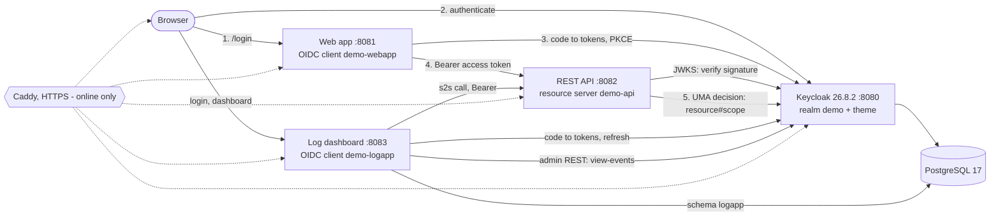
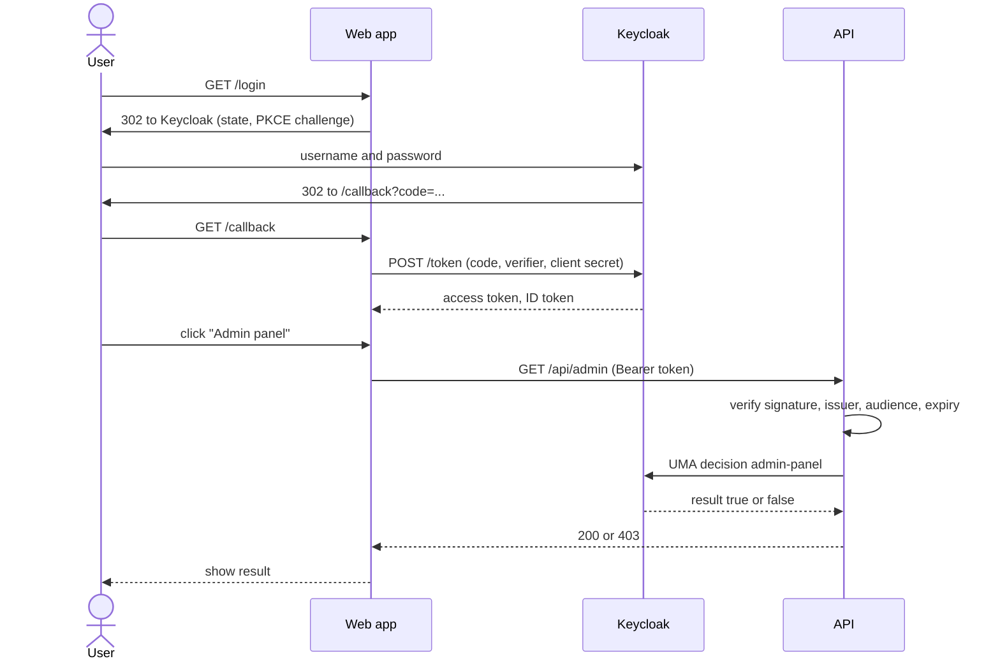

# Keycloak Demo Implementation

A complete, reproducible demonstration of [Keycloak](https://github.com/keycloak/keycloak) 26.8.2 that runs
locally with **one command** and deploys online behind automatic HTTPS.

| Capability | Where it is demonstrated |
|---|---|
| Authentication (OIDC authorization code + PKCE, SSO, logout, brute-force protection) | `webapp/`, realm `demo` |
| Authorization (roles, groups, Keycloak Authorization Services: resources, scopes, policies, permissions) | `api/`, `keycloak/realm/demo-realm.json` |
| Realm configuration as code (users, roles, groups, clients, theme, i18n, events) | `keycloak/realm/demo-realm.json` |
| Client applications (confidential web app, resource-server API, service client, public CLI client) | `webapp/`, `api/`, `service/`, `scripts/verify.sh` |
| Service-to-service authentication (client credentials, machine role `app-service`) | `service/service_client.py`, client `demo-service` |
| Log dashboard: auth events, API access, token refresh/expiry, service-to-service, admin statistics | `logapp/`, client `demo-logapp` |
| Reproducible containers (Docker and Podman) | `docker-compose.yml`, `*/Dockerfile` |
| Online deployment with Let's Encrypt HTTPS | `docker-compose.prod.yml`, `deploy/Caddyfile` |

## Quick start (local)

Prerequisite: [Podman](https://podman.io) or Docker with the compose plugin, plus `curl` and `python3`.

```bash
scripts/start.sh      # generates .env with random secrets on first run, builds and starts everything
scripts/verify.sh     # 44 end-to-end checks (login, tokens, authorization, service-to-service, log dashboard)
```

Open the web app at <http://localhost:8081> and sign in as `alice` or `bob`
(passwords are in your `.env`: `DEMO_USER_PASSWORD`, `DEMO_ADMIN_PASSWORD`).
The log dashboard is at <http://localhost:8083> (sign in as `bob` to see every user's events and the admin panel).
The Keycloak admin console is at <http://localhost:8080/admin> (user and password from `.env`).

Stop with `scripts/stop.sh`; remove everything with `scripts/cleanup.sh` and `scripts/cleanup-images.sh`.

See [Docs/Quickstart.md](Docs/Quickstart.md) for the full walk-through.

## Documentation

| Document | Content |
|---|---|
| [Docs/Quickstart.md](Docs/Quickstart.md) | Local setup, tour of the demo, curl examples, tests, troubleshooting |
| [Docs/Deployment.md](Docs/Deployment.md) | Online deployment step by step (VPS with HTTPS, other platforms) and post-deployment verification |
| [Docs/Configuration.md](Docs/Configuration.md) | Dependencies, every environment variable, realm model, customization options |
| [Docs/logging-system-report.html](Docs/logging-system-report.html) | Self-contained report of the log dashboard: sources, tests, schemas, screenshots, per-claim verification status. Rebuild with `.venv/bin/python scripts/build_report.py` |
| [Docs/Architecture.md](Docs/Architecture.md) | Components, flows and security decisions with diagrams |

## Architecture



## Workflow



## Project layout

```
keycloak/          Keycloak image (Dockerfile), realm JSON, custom login theme
webapp/            Flask OIDC client (Authlib) + Dockerfile
api/               Flask resource server (PyJWT + Authorization Services) + Dockerfile
deploy/Caddyfile   HTTPS reverse proxy for online deployments
docker-compose.yml, docker-compose.prod.yml, .env.example
scripts/           start, stop, verify (+ verify_logapp.py), init-env, cleanup, cleanup-images, build_report.py
logapp/            Flask log dashboard: event capture, Keycloak event sync, admin stats (PostgreSQL schema `logapp`)
service/           Service-to-service client (client credentials grant)
tests/             213 unit and configuration tests (pytest)
Docs/              Quickstart, Deployment, Configuration, Architecture
```

## Tests

```bash
uv venv .venv && uv pip install --python .venv/bin/python -r requirements.txt   # or: python3 -m venv .venv && .venv/bin/pip install -r requirements.txt
.venv/bin/python -m pytest -q                         # unit tests, no containers needed
scripts/verify.sh                                     # end-to-end, needs the running stack (covers the PostgreSQL path; unit tests use SQLite)
```

## Security notes

* The demo realm ships users, a password-grant client (`demo-cli`) and self-registration for convenience.
  For anything beyond a demo set `DEMO_CLI_ENABLED=false`, `DEMO_REGISTRATION_ALLOWED=false` and
  restrict `/admin` with `ADMIN_ALLOWED_CIDR` (see [Docs/Deployment.md](Docs/Deployment.md#hardening-checklist)).
* The log dashboard stores usernames and IP addresses in the `logapp` schema; define a retention policy ([Docs/Deployment.md](Docs/Deployment.md#hardening-checklist)).
* No secret is stored in the repository: `.env` is generated with random values and is git-ignored.

## License

This project is released under the **Apache License 2.0**, the same license as Keycloak itself.
Keycloak is a Cloud Native Computing Foundation incubating project, copyright the Keycloak authors
([source repository](https://github.com/keycloak/keycloak)).
