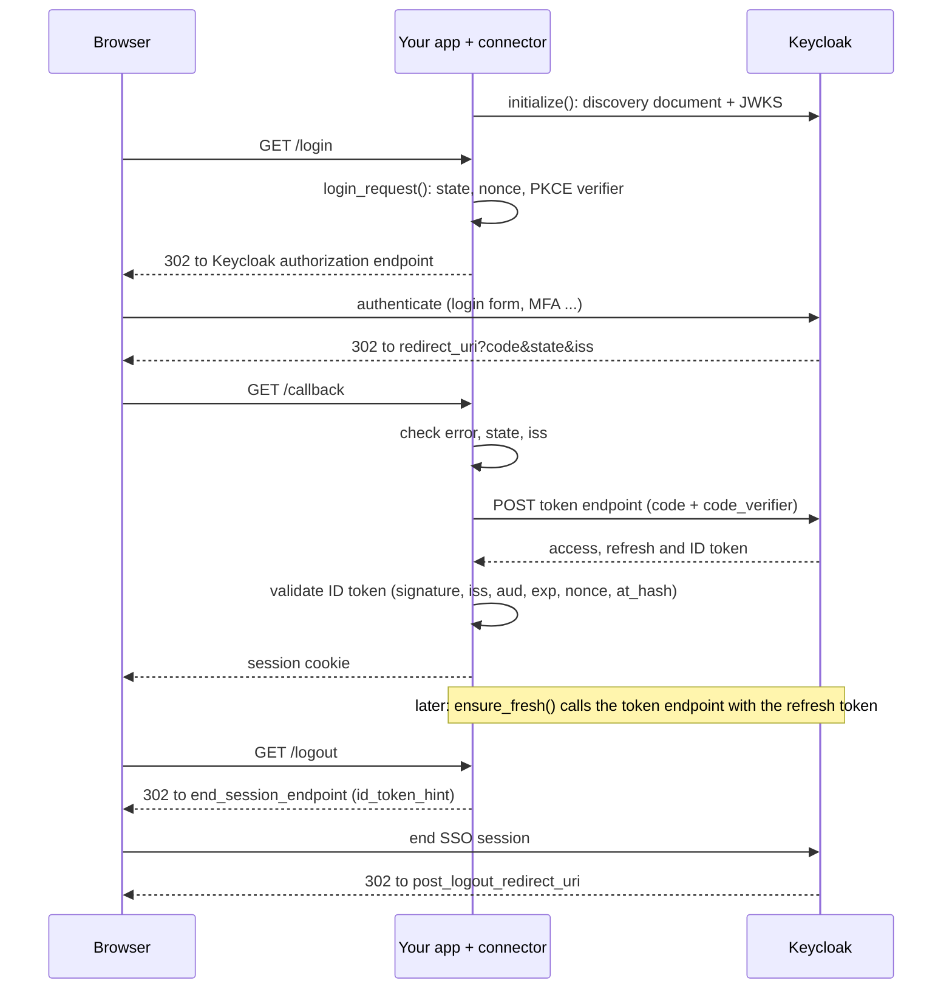

# Keycloak Connector

A small, framework-agnostic Python module that adds **Keycloak sign-in (OAuth 2.0 / OpenID Connect)** to a web
application. You give it the realm, client ID, client secret, server URL and redirect URI; it gives you four
operations: **initialize, login, refresh and logout**, plus offline token validation.

- Authorization Code flow with **PKCE (S256)**, `state`, `nonce` and RFC 9207 `iss` checks
- ID and access token validation: signature (JWKS with `kid` rotation), issuer, audience, expiry, `nonce`, `at_hash`
- Token refresh with a clear "user must sign in again" signal, and a one-call `ensure_fresh()`
- RP-initiated logout (browser) and back-channel logout (server to server)
- Retries with exponential backoff, request timeouts, TLS and custom CA support
- Typed errors that never contain tokens or secrets; secrets are hidden from `repr()`
- Only two runtime dependencies: `requests` and `PyJWT[crypto]`

## Contents

1. [Install](#install)
2. [Quick start](#quick-start)
3. [Configuration](#configuration)
4. [API reference](#api-reference)
5. [How the flow works](#how-the-flow-works)
6. [Usage scenarios](#usage-scenarios)
7. [Register a client in Keycloak](#register-a-client-in-keycloak)
8. [Testing](#testing)
9. [Security notes](#security-notes)
10. [Troubleshooting](#troubleshooting)
11. [License](#license)

## Install

Python 3.10 or newer.

```bash
cd connector
uv venv && uv pip install -r requirements.txt     # PyJWT[crypto] and requests, versions pinned
```

Then either install the folder as a package (`uv pip install ./connector`) or put `connector/` on `PYTHONPATH`
(`from keycloak_connector import ...`).

## Quick start

```python
import os

from keycloak_connector import KeycloakConfig, KeycloakConnector, LoginRequest, TokenSet

kc = KeycloakConnector(KeycloakConfig(
    server_url="https://auth.example.com",        # Keycloak base URL, without /realms/...
    realm="demo",
    client_id="my-web-app",
    client_secret=os.environ["KEYCLOAK_CLIENT_SECRET"],   # omit for a public client
    redirect_uri="https://app.example.com/callback",
    post_logout_redirect_uri="https://app.example.com/",
)).initialize()                                    # 1. fails fast if Keycloak or the realm is wrong

# 2. Login: send the browser to Keycloak, remember the request server side.
login = kc.login_request()
session["login"] = login.to_session()
return redirect(login.url)

# 3. Callback (the redirect URI): validates state, exchanges the code, validates the ID token.
tokens = kc.handle_callback(request.args, LoginRequest.from_session(session.pop("login")))
session["tokens"] = tokens.to_dict()

# 4. Before every call to a protected API: refresh when the access token is about to expire.
tokens = kc.ensure_fresh(TokenSet.from_dict(session["tokens"]))
session["tokens"] = tokens.to_dict()

# 5. Logout: end the Keycloak session too.
return redirect(kc.logout_url(tokens))
```

A complete Flask application is in [`examples/flask_app.py`](examples/flask_app.py). It reads the `KEYCLOAK_*`
variables from the table below (`FLASK_SECRET_KEY` is optional; a random one is generated per start) and prints
what is missing if the configuration is incomplete. Start it with `python connector/examples/flask_app.py` after
exporting the variables. With the demo stack of this repository, `scripts/run_connector_example.sh` does it for you:
it reads `.env`, uses the registered `demo-logapp` client, pauses the log dashboard (same port 8083) and starts
it again when you press Ctrl+C. Then open http://localhost:8083/ (use `localhost`, not `127.0.0.1`).

## Configuration

Pass a `KeycloakConfig` directly, or build it from environment variables with `KeycloakConfig.from_env()`
(prefix `KEYCLOAK_` by default; `from_env(prefix="MYAPP_")` changes it). Invalid or missing values raise
`ConfigError` listing **every** problem at once.

| Parameter | Environment variable | Default | Description |
|---|---|---|---|
| `server_url` | `KEYCLOAK_SERVER_URL` | required | Keycloak base URL, e.g. `https://auth.example.com`. Must equal the hostname Keycloak announces as issuer. |
| `realm` | `KEYCLOAK_REALM` | required | Realm name. The issuer is `<server_url>/realms/<realm>`. |
| `client_id` | `KEYCLOAK_CLIENT_ID` | required | Client ID registered in Keycloak. |
| `client_secret` | `KEYCLOAK_CLIENT_SECRET` | none | Secret of a confidential client. Empty means public client (PKCE only). Never logged. |
| `redirect_uri` | `KEYCLOAK_REDIRECT_URI` | required | Callback URL of your app; must be registered on the client. |
| `post_logout_redirect_uri` | `KEYCLOAK_POST_LOGOUT_REDIRECT_URI` | none | Where Keycloak sends the browser after logout; must be registered. |
| `scopes` | `KEYCLOAK_SCOPES` | `openid profile email` | Space or comma separated; must contain `openid`. |
| `audience` | `KEYCLOAK_AUDIENCE` | none | Expected `aud` of access tokens. Without it the audience is not checked. |
| `use_pkce` | `KEYCLOAK_USE_PKCE` | `true` | Send an S256 code challenge. Keep it on. |
| `verify` | `KEYCLOAK_VERIFY_TLS`, `KEYCLOAK_CA_BUNDLE` | `true` | TLS verification: `True`, or a CA bundle path. `false` is for local experiments only. |
| `timeout` | `KEYCLOAK_TIMEOUT` | `10` | Seconds per HTTP request. |
| `retries` | `KEYCLOAK_RETRIES` | `2` | Extra attempts after network errors and HTTP 5xx answers. |
| `backoff` | none | `0.3` | First retry delay in seconds; doubles each attempt. |
| `leeway` | `KEYCLOAK_LEEWAY` | `10` | Clock skew tolerated for `exp`, `nbf` and `iat`, in seconds. |
| `refresh_margin` | `KEYCLOAK_REFRESH_MARGIN` | `30` | `ensure_fresh()` refreshes tokens expiring within this many seconds. |
| `jwks_ttl` | `KEYCLOAK_JWKS_TTL` | `300` | Seconds the signing keys are cached. |
| `discovery_ttl` | none | `3600` | Seconds the discovery document is cached. |
| `allowed_algs` | none | `("RS256",)` | Accepted signature algorithms. `none` is rejected. |
| `extra_params` | none | `{}` | Extra authorization-request parameters, e.g. `{"kc_idp_hint": "github"}`. |

Example `.env` (never commit real values):

```bash
KEYCLOAK_SERVER_URL=https://auth.example.com
KEYCLOAK_REALM=demo
KEYCLOAK_CLIENT_ID=my-web-app
KEYCLOAK_CLIENT_SECRET=
KEYCLOAK_REDIRECT_URI=https://app.example.com/callback
KEYCLOAK_POST_LOGOUT_REDIRECT_URI=https://app.example.com/
```

## API reference

All methods raise subclasses of `KeycloakConnectorError`.

### `KeycloakConnector`

| Method | Purpose |
|---|---|
| `KeycloakConnector(config, session=None)` | Create the connector. `session` is an optional `requests.Session` (proxies, mTLS, tests). |
| `initialize()` | Load discovery document and signing keys now; verifies the issuer. Returns `self`. Call once at start-up. |
| `health()` | `True` when Keycloak answers discovery correctly; never raises. Use it for readiness probes. |
| `login_request(login_hint=None, prompt=None, scopes=None, extra_params=None)` | Build the authorization URL. Returns a `LoginRequest` (`url`, `state`, `nonce`, `code_verifier`). Keep `to_session()` server side. |
| `handle_callback(params, login)` | Process the redirect: error parameter, `state`, `iss`, code exchange, ID token validation. Returns a `TokenSet`. |
| `exchange_code(code, login)` | Only the code exchange and ID token validation (used by `handle_callback`). |
| `validate_id_token(token, nonce=None, access_token=None)` | Verify an ID token; returns the claims. |
| `validate_access_token(token, audience=None)` | Offline check of a bearer token (signature, issuer, expiry, optional audience); returns the claims. |
| `refresh(tokens)` | Refresh with a `TokenSet` or a raw refresh token. Raises `RefreshError`. |
| `ensure_fresh(tokens)` | Returns `tokens` untouched while valid, otherwise refreshes. |
| `logout_url(tokens=None, post_logout_redirect_uri=None, state=None)` | URL for browser logout (OIDC RP-initiated logout). |
| `logout_backchannel(tokens)` | End the session server to server using the refresh token. Returns `True` on success. |
| `client_credentials(scopes=None)` | Service-to-service token (needs a client secret and service accounts enabled). |
| `userinfo(access_token)` | Call the userinfo endpoint. |

### `TokenSet`

`access_token`, `refresh_token`, `id_token`, `expires_at`, `refresh_expires_at`, `scope`, `claims` (validated
ID token claims). Helpers: `expires_in(now)`, `is_access_expired(now, margin)`, `can_refresh(now)`,
`to_dict()` / `from_dict()` for session storage. `repr()` never shows token values.

### Errors

```text
KeycloakConnectorError
├── ConfigError            invalid or missing configuration
├── DiscoveryError         Keycloak unreachable, realm/issuer mismatch, bad discovery or JWKS
├── StateMismatchError     callback state or issuer does not match (possible CSRF / mix-up)
├── AuthorizationError     Keycloak returned ?error=...  (.error, .description)
├── TokenValidationError   signature, issuer, audience, expiry, nonce or at_hash invalid
└── TokenError             token endpoint rejected the request (.error, .status)
    └── RefreshError       refresh failed; .reauth_required is True when the user must sign in again
```

Recommended handling: `AuthorizationError` -> show "sign-in cancelled"; `StateMismatchError` and
`TokenValidationError` -> restart the login; `RefreshError` with `reauth_required` -> redirect to `/login`;
`DiscoveryError` and other `TokenError` -> Keycloak problem, show an error page and retry later.

## How the flow works



## Usage scenarios

### 1. Confidential web application (server side rendered)

The Quick start above. The secret stays on the server; PKCE is used in addition.

### 2. Public client (single page app backend-for-frontend, mobile callback handler)

Leave `client_secret` empty. The connector then sends `client_id` in the form instead of HTTP Basic
authentication, and PKCE is the only proof for the code exchange. Register the client in Keycloak with
*Client authentication* off.

```python
KeycloakConnector(KeycloakConfig(server_url=..., realm="demo", client_id="spa", redirect_uri="https://app.example.com/cb"))
```

### 3. Configuration from environment variables (containers, 12-factor)

```python
kc = KeycloakConnector(KeycloakConfig.from_env()).initialize()
```

With several Keycloak clients in one process use prefixes: `KeycloakConfig.from_env(prefix="PORTAL_KC_")`.

### 4. Behind a reverse proxy and HTTPS (online deployment)

`server_url` must be **exactly** the public address Keycloak announces (its `KC_HOSTNAME`), for example
`https://auth.example.com`, not the internal container address. The connector verifies this at `initialize()`:
a mismatch raises `DiscoveryError: issuer mismatch ...` telling you both values. The `redirect_uri` must be the
public HTTPS URL of your app. If your app runs behind a proxy, make sure the app generates `https://` URLs (for
Flask: `ProxyFix`).

### 5. Private CA or self-signed certificate

```python
KeycloakConfig(..., verify="/etc/ssl/certs/my-ca.pem")       # or KEYCLOAK_CA_BUNDLE=/etc/ssl/certs/my-ca.pem
```

`verify=False` disables certificate checks and must never be used in production.

### 6. Protect an API (resource server): validate bearer tokens only

```python
claims = kc.validate_access_token(bearer_token, audience="my-api")   # raises TokenValidationError
if "app-admin" not in claims.get("realm_access", {}).get("roles", []): ...   # 403
```

For this to work the access token must contain your API as audience: add an *Audience* mapper to the client
scope in Keycloak. Signature, issuer and expiry are always checked, offline, with cached keys.

### 7. Service-to-service (client credentials)

```python
svc = KeycloakConnector(KeycloakConfig(server_url=..., realm="demo", client_id="worker",
                                       client_secret=secret, redirect_uri="https://worker.example.com/unused"))
token = svc.client_credentials().access_token      # cache it until tokens.expires_at
```

Enable *Service accounts roles* on the client. The `redirect_uri` is required by the configuration but unused here.

### 8. Silent single sign-on check and forced re-login

```python
kc.login_request(prompt="none")      # no UI; Keycloak answers ?error=login_required when there is no SSO session
kc.login_request(prompt="login")     # always ask for credentials again
kc.login_request(login_hint="alice@example.com", extra_params={"kc_idp_hint": "github"})
```

### 9. Keeping tokens fresh in a web app

```python
tokens = kc.ensure_fresh(TokenSet.from_dict(session["tokens"]))   # refreshes when < refresh_margin seconds remain
session["tokens"] = tokens.to_dict()                              # store the possibly rotated tokens
```

Catch `RefreshError`; when `err.reauth_required` is true clear the session and redirect to `/login`.

### 10. Tests without Keycloak

Inject a fake HTTP session: `KeycloakConnector(config, session=my_fake, clock=my_clock, sleep=lambda s: None)`.
The repository's `tests/conftest.py` contains `FakeKeycloak`, a complete in-memory realm you can copy.

## Register a client in Keycloak

Admin console -> your realm -> *Clients* -> *Create client*:

1. *Client type* **OpenID Connect**, *Client ID* = `client_id`.
2. *Client authentication* **On** for a confidential client (then copy the secret from the *Credentials* tab), **Off** for a public one.
3. *Standard flow* **On**. Turn *Direct access grants* **Off** unless you need the password grant.
4. *Valid redirect URIs*: exactly your `redirect_uri` (no wildcards in production).
5. *Valid post logout redirect URIs*: your `post_logout_redirect_uri`.
6. *Advanced -> Proof Key for Code Exchange Code Challenge Method*: **S256**.
7. For `client_credentials`: *Service accounts roles* **On**.

The demo stack in this repository already has such clients in `keycloak/realm/demo-realm.json`
(`demo-logapp` for the browser flow, `demo-service` for client credentials).

## Testing

**Unit tests, no Keycloak needed** (in-memory fake realm, about 100 tests, 99 % line and branch coverage):

```bash
uv venv && uv pip install -r requirements.txt           # from the repository root
.venv/bin/python -m coverage run --branch --source=connector/keycloak_connector -m pytest -q \
  tests/test_errors.py tests/test_pkce.py tests/test_config.py tests/test_tokens.py \
  tests/test_discovery.py tests/test_connector.py tests/test_flask_app.py
.venv/bin/python -m coverage report -m
```

**Integration test against the running demo Keycloak** (start the stack first, see `Docs/Quickstart.md`):

```bash
.venv/bin/python scripts/verify_connector.py            # reads .env; prints PASS/FAIL lines, no secrets
```

It signs in as two demo users through the real login form, validates ID and access tokens, calls userinfo,
refreshes, requests a client-credentials token, performs both logout styles and checks the negative cases
(forged state, damaged token, wrong audience, refresh after logout). `scripts/verify.sh` runs it as well.

## Security notes

- **Keep tokens server side.** Put `TokenSet` in a server-side session store. A signed cookie (Flask default) is readable by the browser.
- `login.to_session()` holds the PKCE verifier and nonce: store it server side as well, and use it **once**.
- Use HTTPS everywhere except `localhost`. Do not set `verify=False` in production.
- Register exact redirect URIs. Use `allowed_algs` only to *narrow* the list (default `RS256`); `none` is refused.
- The JWKS is refetched at most once every 10 seconds on an unknown `kid`, so forged tokens cannot flood Keycloak.
- Exception messages, `repr()` of `KeycloakConfig`, `TokenSet` and `LoginRequest` contain no secrets or tokens; do not add them to your own logs.
- Offline validation cannot see sessions revoked at Keycloak. For high-risk actions call `userinfo()` or keep access-token lifetimes short.

## Troubleshooting

| Symptom | Likely cause and fix |
|---|---|
| `DiscoveryError: issuer mismatch: configured 'http://x/realms/demo' but Keycloak announces 'https://y/realms/demo'` | `server_url` differs from Keycloak's public hostname (`KC_HOSTNAME`, proxy headers). Use the announced value. |
| `DiscoveryError: cannot reach Keycloak ... ConnectionError` | Wrong host or port, Keycloak not started, firewall, or the app container cannot resolve the name. Test with `curl <server_url>/realms/<realm>/.well-known/openid-configuration`. |
| `DiscoveryError: discovery document request answered HTTP 404` | Wrong realm name, or an old Keycloak path prefix (`/auth`). Put it into `server_url`: `https://host/auth`. |
| SSL errors (`CERTIFICATE_VERIFY_FAILED`) | Private CA: set `verify` or `KEYCLOAK_CA_BUNDLE`. Do not disable verification in production. |
| Keycloak page "Invalid parameter: redirect_uri" | `redirect_uri` is not registered on the client or differs (scheme, host, port, trailing slash). |
| Keycloak page "Invalid redirect uri" on logout | Register `post_logout_redirect_uri` under *Valid post logout redirect URIs*. |
| `StateMismatchError` | Session cookie lost between `/login` and `/callback` (cookie `SameSite`, `Secure` over plain http, different host name such as `127.0.0.1` vs `localhost`, multiple workers without shared sessions), or the user used the back button. |
| `StateMismatchError: issuer of the callback ...` | The callback `iss` differs from the configured realm: wrong realm in the authorization URL or a mix-up attack. |
| `AuthorizationError: access_denied` / `login_required` | The user cancelled, or `prompt=none` found no SSO session. Normal; offer a login button. |
| `TokenError: invalid_grant` on code exchange | Code used twice, expired (they live about a minute), or redirect URI / PKCE verifier differs from the login request. Start again at `/login`. |
| `TokenError: invalid_client` / `unauthorized_client` | Wrong or missing `client_secret`, *Client authentication* off for a client with a secret, or *Service accounts* off for client credentials. |
| `TokenValidationError: token audience does not match` | ID token: wrong `client_id`. Access token: add an Audience mapper in Keycloak or leave `audience` unset. |
| `TokenValidationError: token has expired` | Clock skew between servers (raise `leeway` or fix NTP), or a stale token: call `ensure_fresh()`. |
| `TokenValidationError: no signing key matches` | Keys were rotated and the token is from before, or the token belongs to another realm. |
| `TokenValidationError: token response has no id_token` | The `openid` scope was not granted: check the client's scopes. |
| `RefreshError ... reauth_required=True` | SSO session ended, refresh token expired or was already used (rotation). Send the user to `/login`. |
| Login works locally but not in the container | `localhost` inside a container is the container itself. Use the service name for server-to-server calls only if Keycloak announces that name, otherwise use the public URL for both. |

Enable diagnostics with `logging.getLogger("keycloak_connector").setLevel(logging.INFO)`; retries and key refreshes are logged without sensitive data.

## License

Apache License 2.0, the same as the project and as [Keycloak](https://github.com/keycloak/keycloak).
